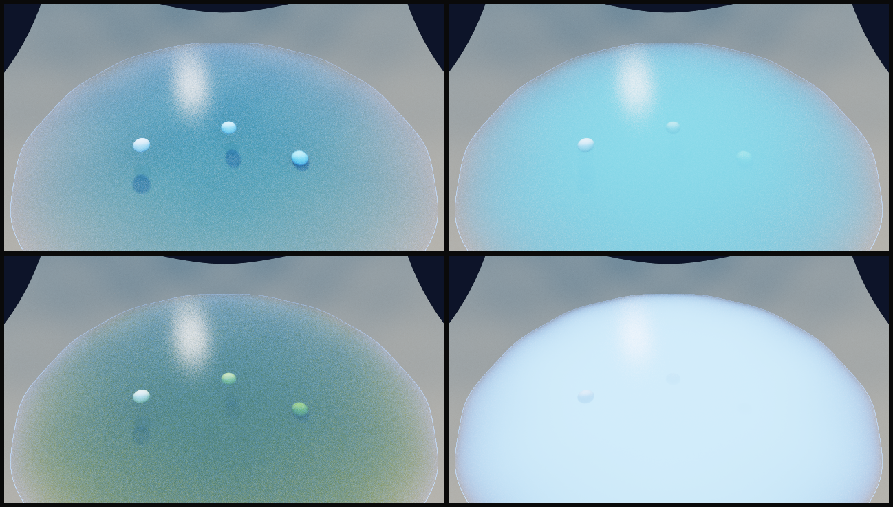

# Water rendering (only when the water is the subject)

> **Read this first. Use the water volume only when the water itself is the subject of the film**: its clarity, colour, turbidity, depth, or objects seen through it
> (Secchi disks, fish, a lakebed). If rivers and lakes are only features on a map (a sensor network on terrain, like the Cache la Poudre film), **do not turn it on**.
> Those are already drawn by the albedo texture and the `riv` river mask, which is simpler and cheaper.
> The water volume costs render time (15-35% more on a flooded test scene), adds sun-glitter noise, changes what the terrain looks like through the surface,
> and needs the camera kept above the terrain's footprint. If you are unsure whether water is the subject, **ask the user** (`sr_intake()` asks this).

<p align="center"></p>
<p align="center"><sub><b>Synthetic scene</b> from <code>tools/water_demo.R</code>. Top row: clear, algal. Bottom row: brown, turbid. Three white spheres sit at 0.45, 0.95 and 1.5 m depth.
The optics are illustrative, not calibrated.</sub></p>

## Turn it on
```r
mesh <- sr_mesh_from_heightfield(H, xr, zr, y0, vexag)
gpu  <- sr_upload_mesh(mesh, albedo, water = c(
  sr_water_preset("algal"),                       # illustrative absorption + scattering per metre (RGB)
  list(level = 2.2,                               # world y of the surface, in scene units
       metres_per_unit = 1,                       # coefficients are per metre; scene units -> metres (see below)
       roughness = 0.03,                          # capillary-wave tilt of the surface (sun glitter); 0 = flat mirror
       cutaway = FALSE)))                         # TRUE: the terrain box gets vertical glass walls (a diorama)
layers <- sr_render_light_layers(gpu, lights, ...)  # nothing else changes; water_depth.f32 is written next to amb.f32 and mask.f32
```
With `water = NULL` (the default) the water code is compiled out of the GPU kernels: **dry scenes cost nothing** (11.3-11.9 s before and 11.6-12.1 s after, with identical output, on a 32-light 512-sample batch).

| `water` field | meaning |
|---|---|
| `level` | world y of the water surface (required) |
| `ior` | index of refraction, 1.333 |
| `absorption`, `scattering` | RGB coefficients (`kd` sets all three absorption values at once); extinction = absorption + scattering |
| `metres_per_unit` | metres per scene unit. Coefficients are multiplied by it, so give them per metre. For a terrain with 1 unit = 1 km and vertical exaggeration `v`, use `1000 / v`. Default 1: coefficients are per scene unit |
| `roughness` | normal tilt, 0 to about 0.05 |
| `cutaway` | `TRUE` adds glass walls on the terrain box where the terrain is below `level` |

Helpers for submerged objects: `sr_sphere_mesh()`, `sr_mesh_append()` (an object takes its colour from the albedo texture at its uv), `sr_paint_albedo()`.

## What it models
- **Dielectric surface:** exact unpolarised Fresnel. Each ray reflects with probability F, otherwise refracts (Snell, total internal reflection handled). Reflections show terrain and the sky; the surface is a flat plane at `level`, tilted by `roughness`.
- **Underwater:** Beer-Lambert attenuation `exp(-sigma_t * length)` along every underwater ray segment, and single scattering (one shared sample point per segment, isotropic phase) for every light.
- **Light rays:** a light reaching an underwater point is attenuated by the water above it and by the surface's Fresnel transmission, along a straight ray.
- **Lights seen through water:** lights are invisible spheres, but after a reflection or refraction they can be seen, so you get sun glitter on the surface and the sun seen from below.
- **Sky:** ambient sky light reaching the lakebed is attenuated the same way; the surface reflects the sky.
- **AOVs:** `water_depth` (path length inside the water to the terrain; the refracted first-hit `uv`, `normal` and `albedo` are returned as before). The mask counts the water surface as covered.

## Checked against closed forms (`tools/test_water.R`, flat lakebed)
| check | worst error |
|---|---|
| wet/dry radiance = (1-F0) e^-kd (1-F45) e^-kd sqrt2 | 0.11% |
| reflected emitter = F(60 degrees) x radiance | 0.65% |
| `water_depth` = depth | 0.10% |
| single-scatter radiance in a deep scattering lake | 0.15% |

## Speed
Flooded Poudre valley, 32 lights, 512 samples: dry 11.6-12.1 s; water with absorption only 14.3 s (+16-22%); with scattering 15-16 s (+25-35%). Scattering costs more because every underwater segment adds a shadow ray per light.
To keep it fast: leave scattering at 0 unless turbidity is the point, use fewer samples (sun glitter needs more of them: 1,000-4,000 for a single light is cheap), and keep `max_bounces` low.

## What it does not do (be honest with the user)
- **Flat water only.** The surface is one horizontal plane. No flowing, sloped or wavy water surfaces (`roughness` fakes small ripples). The issue that asked for this proposed tagging triangles as water; the analytic plane is faster and exact for lakes, but cannot do rivers on slopes.
- **No caustics or refracted shadows.** Light rays go straight through the surface, so submerged objects cast approximate shadows and there are no caustic patterns.
- **Single scattering, isotropic.** Very turbid water is only approximate.
- **No re-tinting at compose time.** The `water_depth` output exists, but the compositor does not yet use it to change clarity or colour after rendering; changing the optics means re-rendering the layers.
- **Keep the camera above the footprint.** The terrain is a thin surface mesh; rays that pass under its edge can hit its underside. Cutaway walls only appear where the terrain is below `level`.
- **Presets are illustrative.** `sr_water_preset()` gives starting looks, not calibrated optics. Calibrate against kd, Secchi depth, Chl-a, DOC or turbidity if you need numbers.
